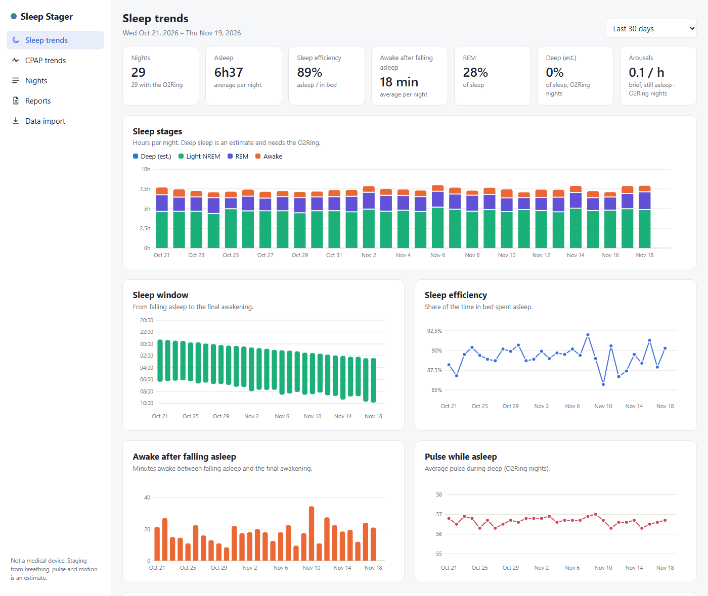
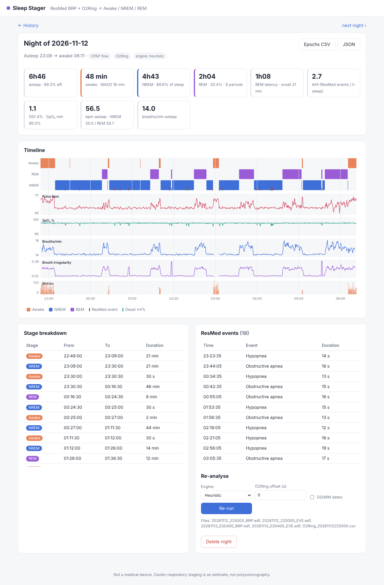
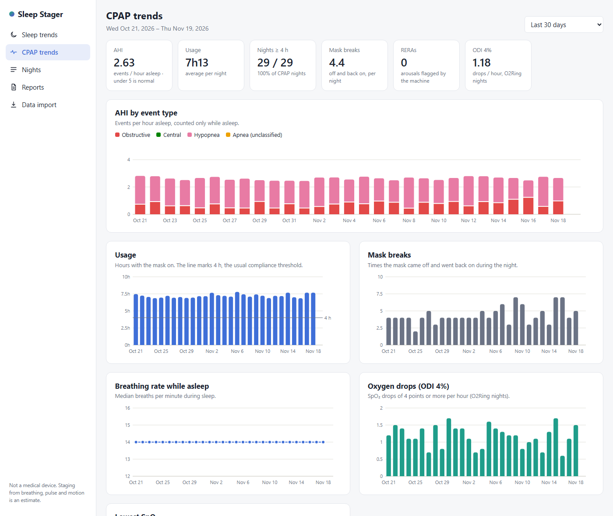
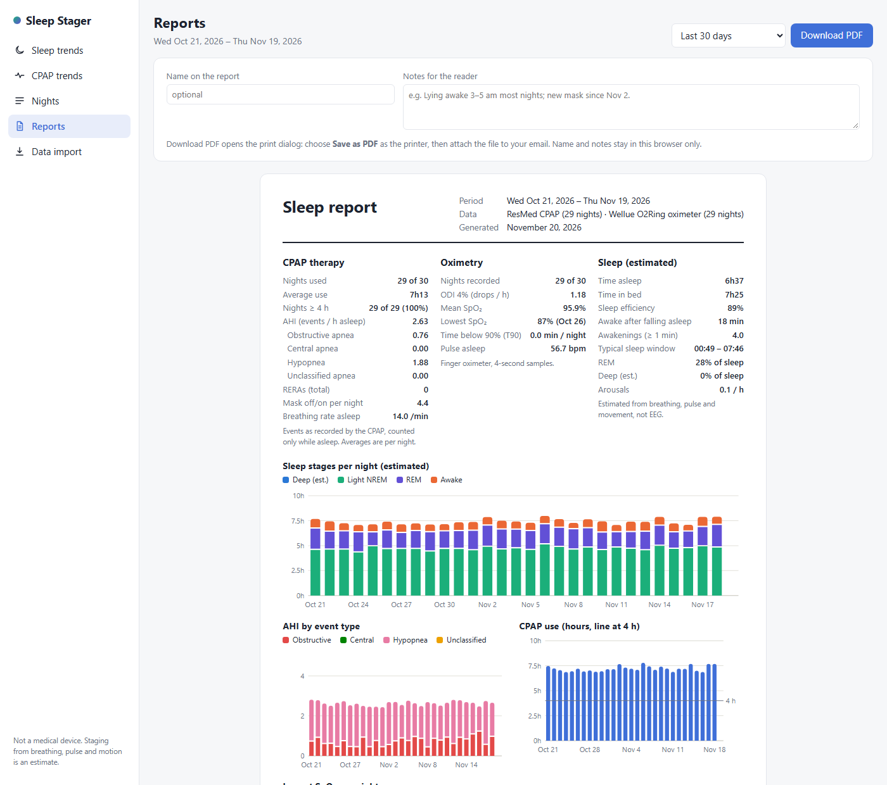

# cpap-sleep-stager

Self-hosted web app that turns a **ResMed CPAP SD card** and/or a **Wellue O2Ring** into a night-by-night sleep picture: an **Awake / NREM / REM** timeline with estimated deep sleep and arousals, CPAP and oxygen trends, and a PDF report you can email to your doctor. Every night is kept in a database, so you can follow your history.



> **Not a medical device.** Sleep stages are *estimated* from breathing, pulse and movement, not EEG. Use them to look at trends, not to diagnose anything.

| | |
|---|---|
|  |  |
| **Night:** stages, pulse, SpO₂, breathing and movement, with ResMed events and mask-off periods | **CPAP trends:** AHI by event type, usage, mask breaks, breathing rate, oximetry |
|  | |
| **Reports:** a PDF summary for a chosen period | |

*Screenshots use the synthetic demo data from `scripts/make_demo_data.py`.*

## Run it

Prebuilt images are published to the GitHub container registry for Intel/AMD (linux/amd64), so a NAS or home server does not have to build anything. You only need [`docker-compose.yml`](docker-compose.yml):

```bash
mkdir sleep-stager && cd sleep-stager
curl -O https://raw.githubusercontent.com/vrouleau/cpap-sleep-stager/main/docker-compose.yml
docker compose pull && docker compose up -d
# → http://<host>:8000
```

Set `TZ` in `docker-compose.yml` to your time zone. Update the same way (`docker compose pull && docker compose up -d`). Data lives in `./data`: `sleep.db` plus the original uploaded files, kept so a night can be re-analysed after an algorithm change or a clock fix. Database changes between versions are applied automatically at start-up. SQLite is the default. Set `DATABASE_URL` to use Postgres (add `psycopg[binary]` to `requirements.txt`).

| Image tag | What it is |
|---|---|
| `latest` | the newest release (recommended) |
| `0.2.0`, `0.2` | a fixed release, to stay on or roll back to |
| `edge` | the current `main` branch |

**The app has no login.** Keep it on your LAN, or put it behind a reverse proxy with authentication: it holds health data.

To build from source instead: clone the repo and run `docker compose up -d --build`.

## Using it

### Dashboard

A sidebar (a tab strip on phones) with five sections:

* **Sleep trends** (home): averages for the range, then sleep stages per night (deep, light NREM, REM, awake), sleep window (falling asleep to final awakening), sleep efficiency, awake after falling asleep, arousals by likely cause, and pulse while asleep (O2Ring nights).
* **Nights**: every night in a table, 30 per page, newest first. Open one for its timeline. **Re-analyse all nights** reruns every night with its own engine and clock correction, oldest first, in the background, so older nights get the newest analysis.
* **CPAP trends**: AHI by event type (obstructive, central, hypopnea, unclassified, counted only while asleep), usage with a 4 h line, mask breaks, breathing rate while asleep, and on O2Ring nights ODI 4% and lowest SpO₂.
* **Reports**: see below.
* **Data import**: upload, plus the most recent imports.

One date-range control above the charts scopes the tiles, every chart and the table: last 7, 30 or 90 days, last 12 months, this month, last month, this year, all nights, or a custom range. It is kept in the URL, so switching tabs keeps it. Ranges over 3 months show weekly averages. Hover a bar or point for its values, and click it to open that night. Colours for stages and event types were checked for colour-blind separation in light and dark mode.

### A night

The timeline stacks the stages (with *Deep* as its own row on O2Ring nights) over pulse, SpO₂, breathing rate, breathing irregularity and movement. On top of that it shows:

* ResMed events as full-height lines, coloured by type, with a toggle;
* mask-off periods as grey bands;
* brief arousals as triangles along the Awake row, coloured by likely cause;
* SpO₂ drops of 4% or more along the SpO₂ panel.

Below the timeline are tiles (time asleep, awake, NREM/REM/deep, REM latency, AHI, ODI, pulse, breathing rate), the CPAP clock check (see below), a stage-by-stage table, the ResMed event list and a *Re-run* form. *Epochs CSV* and *JSON* export everything.

**Wake-ups.** One row per awakening of 5 minutes or more, plus the final one. Wake marks separated by less than 5 minutes of "sleep" count as one awakening, because a minute of dozing inside a long wake isn't two wake-ups. Shorter wakes are counted as *brief* in the header. It shows when it happened, how long it lasted, and which stage it came out of (and whether REM was in the 5 minutes before). It also shows:

* **Pulse before:** whether the O2Ring pulse had been **building up** over the 30–60 min before (≥ 3 bpm, relative to the night's normal for the stage, because REM runs higher than NREM). A build-up is a slow internal change: the body clock's early-morning rise (cortisol, adrenaline), a filling bladder or a blood-sugar dip can all look like this. The pulse can't tell them apart, and it doesn't measure cortisol. The pulse *jump* at the moment of waking is shown for information only. Waking itself raises the pulse, so it says nothing about the cause (an earlier version labelled it "abrupt").
* **Just before:** CPAP events, O₂ dips and movement in the 2 minutes before. From the machine data (`PLD.edf`) it also shows a **pressure rise** (the auto-CPAP reacting to flow limitation or snoring), **flow limitation** or **snoring** from 10 minutes before the scored start to 25 minutes into it. Those mean you were still asleep, and slowly building wake-ups are often scored early. It shows **large leak** (≥ 24 L/min) from 10 minutes before to 2 minutes after; leak later than that usually comes from moving once awake.
* **Afterwards:** "stayed up" means that 2–5 minutes into a longer wake-up the pulse was still high, as with a racing mind rather than a brief wake-and-roll-over.
* **Bathroom:** whether the mask came off and how long after waking (straight away suggests the urge or the decision to get up came first; after lying awake a while suggests going "while at it"), and how long you stayed awake after it went back on.

On simulated nights every wake-up was found, every simulated pressure rise before a wake-up was flagged with no false alarms, and the build-up label was right about 3 times in 4. Read it as a pattern over many nights, not a verdict on one.

**Machine data (PLD).** The timeline also shows therapy pressure, leak and flow limitation from the ResMed `*_PLD.edf` files (one value every 2 s). Channel names differ by model (AirSense `Press.2s`, `Leak.2s`, `FlowLim.2s`, `Snore.2s`; S9 `Therapy Pres`, `FFL Index`, …) and are matched by keyword. Leak is converted from L/s to L/min. Older imports didn't keep PLD files. Re-insert the SD card (without *Replace*) and existing nights pick them up; then *Re-analyse all nights*.

**Your wake log.** Log the times you remember being awake (for example *01:30 to 05:15* after the dog woke you). They show as a dark band on the timeline, and the page reports how much of that time the app also staged as awake. It is the only ground truth you have without a sleep lab. Use it to judge how far to trust a night, and as data for tuning the rules. Log entries survive re-runs and re-uploads.

### Reports

A sleep report for a chosen period, to send to your doctor:

* three summary blocks:
  * **CPAP therapy:** usage, nights over 4 h, AHI by event type, RERAs, mask breaks;
  * **oximetry:** ODI 4%, mean and lowest SpO₂, T90, pulse;
  * **sleep (estimated):** time asleep, efficiency, awake time, typical sleep window, REM, deep, arousals;
* four charts;
* a night-by-night table (monthly averages beyond 3 months);
* your name and notes, which are kept in your browser only;
* a note on how everything was measured.

*Download PDF* opens the print dialog; pick *Save as PDF* and attach the file to your email. It always prints in light colours on A4/Letter, and a 30-day report fits on two pages.

### Uploading

* **Drag in whole folders**, or use *Choose folder*: the ResMed SD card (or its `DATALOG` folder) and/or O2 Insight Pro's `DATA` folder (`%LOCALAPPDATA%\O2 Insight Pro\DATA`). Loose `*_BRP.edf` / `*_EVE.edf` files, O2Ring CSVs or a zip work too.
* The browser keeps only what the analysis uses: BRP, EVE and PLD (it skips `STR.edf`, `SETTINGS`, SAD/CSL and the rest) and shows what it found per night before uploading.
* It leaves out nights you already have unless *Replace* is ticked, so re-inserting the card only uploads the new nights.
* Uploads go in batches, oldest night first, with progress and a per-night result list.
* Nights are split automatically, noon to noon, and named after the evening they start.
* Short CPAP sessions (under 30 min in all) more than 2 h away from the night are left out, such as testing the machine or a mask in the afternoon, or for a minute the next morning. Otherwise the hours in between would count as awake. The night page lists what was ignored.
* A new night with less than 1 h of recording is not imported at all.
* **Auto-correct CPAP clock** (on by default): see below.

### Clock sync and daylight saving time

The O2Ring takes its time from your phone on every sync, so the app treats it as the true clock and shifts the **ResMed** timestamps to match. ResMed machines never adjust for DST. The AirSense 10 clock has to be changed by hand. The AirSense 11 has no clock you can set and, according to user reports, never resyncs it over cellular, so it can also drift by minutes, sometimes tens of minutes over months. After a time change the CPAP is often exactly an hour off.

When a night has both devices, the app estimates the offset like this:

1. **Morning anchor.** You take the mask and the ring off within a minute or two of each other, so the gap between the last CPAP session's end and the ring's last reading shows the clock error to within a few minutes. When the total correction this implies is within 10 min of a whole hour (no error, or a missed DST change), the search below is narrowed to ±2 min around that hour. Without it, nights with few mask on/off markers could lock onto a chance cluster of movement 45 or 95 min away. If it is not near a whole hour (drift, or the ring kept on after the mask), the full search is used.
2. **Mask on/off vs. ring motion.** Each BRP file starts and ends when the mask goes on or comes off, and your hands move the ring at that moment. The app tries every shift up to ±2 h, covering drift plus a missed DST hour, and picks the one that puts the most ring motion on those instants. It's accurate to about the ring's 4-s sampling. Mid-night bathroom breaks give the sharpest markers. For a guaranteed marker, shake your ring hand when you press Start.
3. **SpO₂ response to apneas** (cross-check). The average finger SpO₂ low point should come about 30 s after a ResMed event ends. It only confirms the estimate to about ±15 s.

**Travelling:** don't touch the AirSense 11. Changing its time zone requires erasing its data, so leave it on home time. Your phone, and so the ring, switches to local time. The app first compares when each device's recording starts and ends to find the rough gap (for example +6 h in Paris), then refines it with the mask on/off markers. The timeline then shows the ring's local time. Two limits: CPAP-only nights reuse the last correction, so wear the ring on your first night away and your first night back. A shift of about 12 h or more (Asia or Australia from Toronto) can split one night into two dates.

The night page shows the result, including a ⏰ "missed DST" note when the shift is about 1 h, a ✈️ note when it's several hours, and an **Apply & re-run** button. With *Auto-correct CPAP clock* ticked on upload, a high-confidence correction is applied automatically. CPAP-only nights then reuse the correction from the closest earlier night that had both devices. You can also set *CPAP clock correction (s)* by hand, for example `-3600` when the machine is still on summer time.

## How staging works

| Input | Read with | Used for |
|---|---|---|
| `DATALOG/YYYYMMDD/*_BRP.edf` | [`pyedflib`](https://github.com/holgern/pyedflib), with a built-in fallback reader for odd ResMed headers | Breath detection at 25 Hz: rate, breath-to-breath interval variability, tidal-amplitude variability, mask-on/off |
| `*_EVE.edf` | pyedflib, or a built-in EDF+ annotation decoder for the EDF+D files ResMed writes | Apneas / hypopneas / RERAs, used for event markers and AHI over *sleep* time |
| O2Ring CSV (O2 Insight Pro / ViHealth export) | [`o2ring-analyzer`](https://pypi.org/project/o2ring-analyzer/) | Pulse, SpO₂ and motion, plus its ODI3/ODI4, T90, nadir and desaturation events |
| O2Ring raw recordings (no extension, e.g. `20261101214802`, in `%LOCALAPPDATA%\O2 Insight Pro\DATA\<device id>`) | built-in decoder | Same as the CSV, without exporting: 4-s SpO₂, pulse and motion |

For each 30-second epoch it computes features over a 2-minute window, then stages:

* **NREM**: metronomic breathing, low and steady pulse, no movement.
* **REM**: irregular breathing (rate *and* depth), more variable pulse, but no movement (atonia). It is suppressed in the first 45 min after sleep onset.
* **Awake**: seeded by movement that means waking (the pulse jumps 5+ bpm, the movement is big, or it lasts more than one epoch; a lone twitch or small position change is not wake) or by mask removal. It is then grown into neighbouring epochs whose pulse is above an **adaptive cut**, between *this night's* NREM pulse and its movement-confirmed wake pulse. Stretches of 4 minutes or more above the cut count as awake even without movement (lying awake quietly).
* **Arousals** (O2Ring nights), counted per hour asleep. They come from two sources:
  * *Brief wake marks:* inside sleep, a wake mark of 1 minute or less stays awake only with both a pulse jump of 8+ bpm and movement. Otherwise it is an arousal and you stay asleep.
  * *Pulse surges inside sleep:* most arousals last 3–15 s and never turn a 30-s epoch into a wake mark. The app finds them on the 1-second pulse trace: a jump of 7+ bpm over the previous minute, at least 3× the pulse's normal wobble over the last 5 min (REM needs a bigger jump), peaking within 10 s.

  Each arousal gets a **likely cause**: *after a CPAP event* (a ResMed apnea, hypopnea or RERA ended just before it), *after an O₂ dip* (a ≥4% desaturation with no scored CPAP event), *with movement*, or *no obvious cause*. The Sleep trends page charts arousals per hour by cause. Mostly "after a CPAP event" points at pressure or mask. Mostly "no obvious cause" points elsewhere: pain, bladder, temperature, alcohol, noise. Pulse surges are a recognised stand-in for EEG arousals, not the same thing. On simulated nights about 80–90% are found, with about 10% over-counting. Nights analysed before this change need *Re-run* to get causes.

All thresholds are relative to the night itself (robust z-scores), so the rules adapt to you. It also works with only one source, though less accurately: CPAP-only cannot really separate quiet wake from REM, and O2Ring-only has no breathing data.

**Deep sleep (estimate, needs the ring):** within NREM, stretches with the night's lowest and steadiest pulse, very regular breathing and no movement, lasting 10 min or more, are marked *Deep*. Breathing alone was tried and did not agree with the ring-based estimate at all, so CPAP-only nights get none. This is not validated against EEG, and pulse has a natural low in the early morning, so late bouts may be calm light sleep rather than true N3. Read it as "your calmest NREM".

**CPAP only (no ring):** a long period of lying awake with the mask on leaves no movement or mask-off marker, but the breathing changes. On real nights with a known awake period it dropped from about 21 to 13 breaths/min and became about twice as irregular for hours, then switched back when sleep returned. So 20 minutes or more of breathing that is at least 15% slower than the night's sleep rate *and* irregular counts as awake, and the awake period grows through short sleep-like gaps (`bw_*` in `DEFAULTS`). REM is irregular too, but it does not slow down like this, and it is rarely that long.

### Optional: `sleepecg` engine

[`sleepecg`](https://github.com/cbrnr/sleepecg)'s `wrn-gru-mesa` model (wake/REM/NREM) can serve as a prior. The respiratory and motion evidence is then fused on top. The catch is that sleepecg was trained on ECG R-peaks, and the O2Ring only exports a smoothed pulse rate. Here beat times are rebuilt by integrating that pulse rate, which keeps heart-rate level and slow variability but loses true beat-to-beat HRV. Treat it as an experiment and compare it against the heuristic on your own nights. It's included in the image. To use it, tick **Use the sleepecg engine** on the *Data import* page. The switch is saved in the data folder (`settings.json`) and survives restarts. `SLEEPECG: "true"` under `environment:` in `docker-compose.yml` only sets the default until the switch is first used. It then appears in the engine picker, and new imports use it by default. You can still pick the heuristic per import, and re-run any night with either engine. `"false"` (the default) hides it. `GET /api/health` reports `sleepecg_status`. To build a slimmer image without it, use `docker compose build --build-arg WITH_SLEEPECG=false`. Age and sex are model inputs, and you can set them on upload.

## API

```
GET    /api/nights                         list + summaries
POST   /api/nights                         multipart: files=..., engine, offset (CPAP clock correction, s),
                                           auto_sync, dayfirst, age, gender, replace, notes
GET    /api/nights/{id}                    summary + per-epoch features/stages + events + wake log
GET    /api/nights/{id}/segments           merged stage runs with start/end
GET    /api/nights/{id}/epochs.csv         per-epoch export
POST   /api/nights/{id}/wake-log           {"start": "01:30", "end": "05:15"} (before noon = next morning)
DELETE /api/nights/{id}/wake-log/{index}
DELETE /api/nights/{id}
POST   /api/reprocess-all?dayfirst=false   re-analyse every night in the background
GET    /api/settings                       {"sleepecg": {enabled, installed, available, status, source}}
PUT    /api/settings                       {"sleepecg": true}
GET    /api/reprocess-all                  progress: running, done, total, errors
```

Bulk import from the SD card, for example from a homelab cron job:

```bash
cd /media/SDCARD && zip -qr /tmp/sd.zip DATALOG
curl -F files=@/tmp/sd.zip -F replace=false http://sleep.local:8000/api/nights
```

## Development

```bash
pip install -r requirements.txt pytest httpx
python scripts/make_demo_data.py demo --nights 30 --start 2026-10-20   # synthetic BRP/EVE/CSV + truth_*.csv
python scripts/make_demo_data.py demo --ring-ahead -3600               # simulate a CPAP that missed DST
DATA_DIR=./data uvicorn app.main:app --reload
pytest -q
```

The tests check readers, grouping, the API round trip, clock sync and staging agreement on **synthetic** nights (about 95% combined). Synthetic data follows the same physiology the rules assume, so this confirms the plumbing, not real-world accuracy. Tuning knobs are in `app/staging/engine.py` (`DEFAULTS`).

```
app/
  ingest/resmed.py            BRP/EVE readers (pyedflib + fallbacks), stray-session trimming
  ingest/o2ring.py            O2Ring CSV (o2ring-analyzer) and raw-recording decoder
  staging/features.py         breath detection + per-epoch features
  staging/engine.py           heuristic staging: wake, REM, deep, arousals (+ ML-prior fusion)
  staging/arousal.py          pulse-surge arousals + likely-cause tagging
  staging/awakenings.py       per wake-up: onset shape, stage before, trigger, pulse after
  staging/sleepecg_engine.py  optional sleepecg prior
  staging/sync.py             CPAP vs O2Ring clock-offset detection (DST, drift, travel)
  pipeline.py                 upload → nights → analysis → summary → DB
  main.py                     FastAPI routes, templates, JSON API
  templates/                  dashboard, night, nights, reports, import pages
  static/charts.js            night timeline
  static/trends.js            trend dashboards and the report
  static/upload.js            folder drag-and-drop upload
scripts/
  make_demo_data.py           synthetic nights for tests and screenshots
  release.sh                  cut a release (see below)
```

### Releases

Every push to `main` runs the tests and publishes `edge`. Tagging a version publishes `latest` and the version tags once the tests pass, and creates a GitHub Release with notes generated from the commits. Cut releases with the script (Git Bash or WSL on Windows, or any shell with git and the GitHub CLI):

```bash
scripts/release.sh patch   # v0.1.0 -> v0.1.1: fixes
scripts/release.sh minor   # v0.1.1 -> v0.2.0: new features
scripts/release.sh major   # v0.2.0 -> v1.0.0: breaking changes
scripts/release.sh minor --dry-run   # show the version and changes, touch nothing
```

The running version is shown at the bottom of the sidebar, linked to its release notes (`edge` builds show their commit), and in `/api/health`.

It refuses to tag unless you are on `main` with nothing uncommitted or unpushed, CI passed on that exact commit, and there are commits since the last release. It then shows the changes, asks for confirmation, and pushes the tag. GitHub does the rest.
